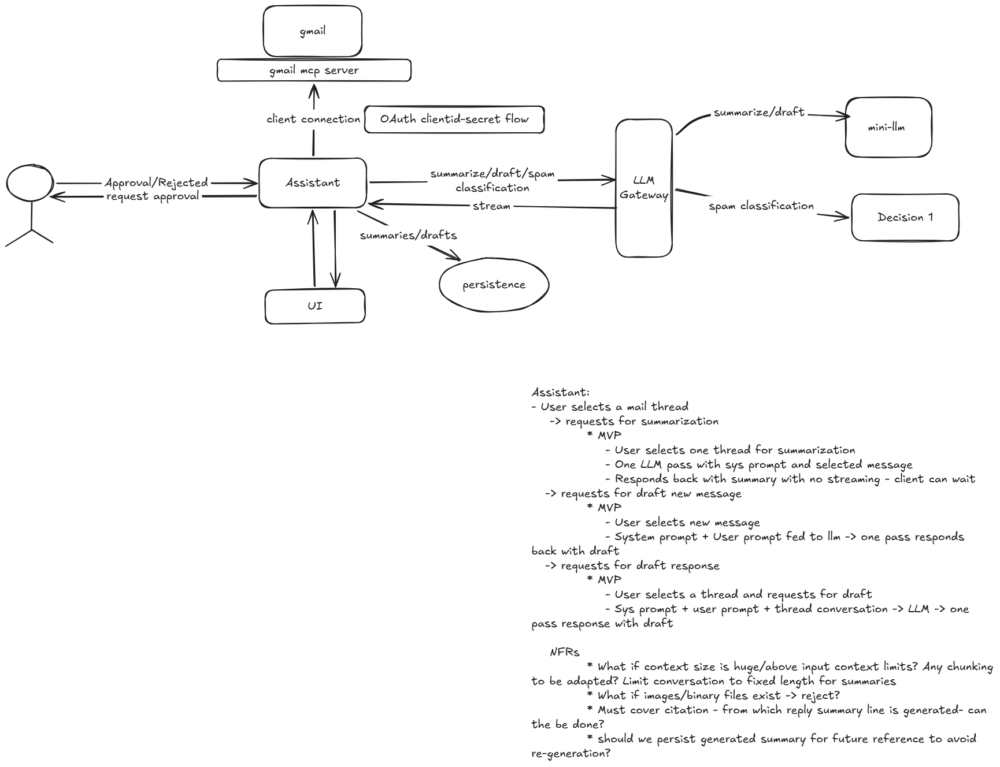

# AI Email Productivity Assistant

High level requirements for this project:
- Summarizes email threads
- Drafts context-aware replies
- Requests human-in-the-loop approval before sending
- Supports locally hosted LLMs



---

## Current Status: Gmail API & Gmail Clone UI

The application includes a Gmail-inspired Web UI and OAuth 2.0 integration with the Gmail REST API:

- **OAuth 2.0 Web Flow**: Uses `Credentials.json` with redirect URI `http://localhost:5000/home`.
- **Backend**: Python Flask REST API (`src/api/`).
- **Frontend**: Gmail-styled SPA (`src/ui/`) featuring:
  - Collapsible sidebar with Inbox, Starred, Sent, Drafts, Trash, Spam and real-time unread badges.
  - Central search bar querying Gmail messages.
  - Multi-select actions (mark as read/unread, trash, star).
  - Conversation thread view with clean HTML rendering and attachment indicators.
  - Reserved AI Assistant quick slots ("Summarize Thread", "AI Draft Reply", "Send with Approval").

---

## Getting Started

### 1. Prerequisites & Virtual Environment
Ensure your virtual environment is active and dependencies are installed:
```powershell
.venv\Scripts\activate
pip install -r requirements.txt
```

### 2. Run the Application
Run the application using the entry point:
```powershell
python run.py
```
or
```powershell
.venv\Scripts\python run.py
```
*(You can also run `python -m src.api.app` or `python src/api/app.py`)*


### 3. Sign In & Authorize
1. Open [http://localhost:5000](http://localhost:5000) in your web browser.
2. Click **Connect with Google**.
3. Grant permission to access your Gmail.
4. Google redirects back to `http://localhost:5000/home`, which saves your authorized `token.json` and loads your inbox.
