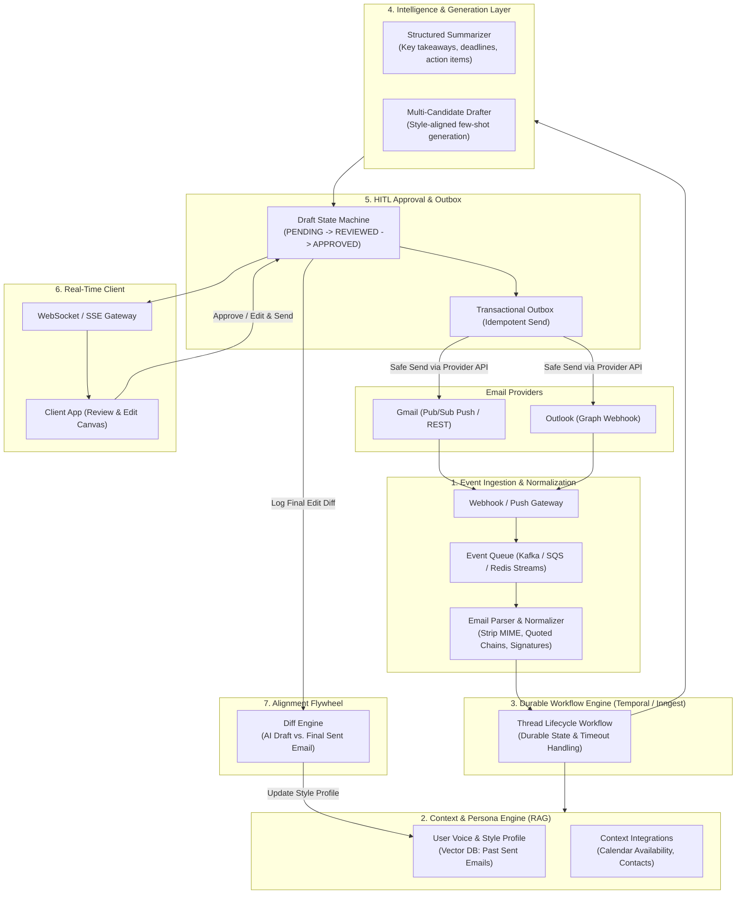
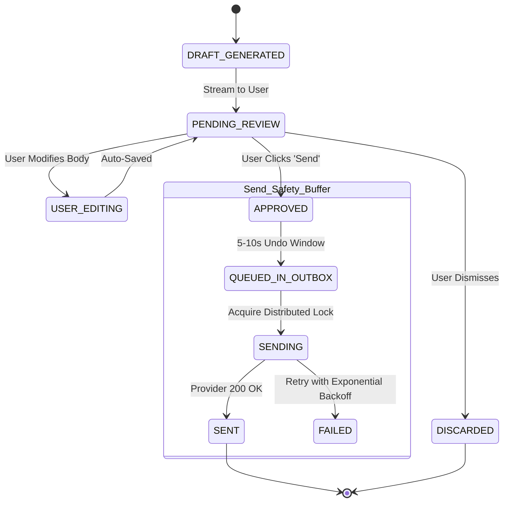

# AI Email Assistant: Architecture & Implementation Plan

## 1. Executive Summary & Core Requirements

This document outlines the architecture for an intelligent email productivity assistant built around three core pillars:
1. **Thread Summarization**: Real-time structured extraction of key points, action items, and deadlines.
2. **Context-Aware Response Drafting**: Generating high-fidelity, persona-aligned reply options.
3. **Human-in-the-Loop (HITL) Approval**: Safe, reliable review-and-send workflow with double-send prevention.

---

## 2. System Architecture



---

## 3. Core Architectural Pillars

### Pillar 1: Pre-Computation via Event-Driven Ingestion (Zero-Wait UX)
* **Goal**: The user never waits on a loading spinner for a summary or draft; options are ready the instant a thread is opened.
* **Mechanism**:
  * New emails trigger background webhooks/polling into an event broker.
  * **Email Cleaner & Normalizer**: Strips raw MIME headers, legal disclaimers, nested quoted reply threads (`> on Jan 5...`), and sign-offs.
  * Clean thread content is passed to the generation pipeline ahead of user interaction.

### Pillar 2: Persona & Context Engine (Style-Aligned Generation)
* **Goal**: Eliminates robotic LLM phrasing by writing in the user's authentic voice.
* **Mechanism**:
  * **Style Memory (Vector Store)**: Embeds the user’s historical sent emails to capture vocabulary, typical sentence length, and salutation style.
  * **Dynamic Few-Shot Injection**: Pulls the 2–3 most relevant historical replies to similar recipients/topics into the prompt context.
  * **Dynamic Integrations (Calendar & CRM)**: Resolves scheduling constraints (e.g., checking Google Calendar availability) and injects open slots automatically.

### Pillar 3: Structured Multi-Candidate Drafting
Instead of producing a single rigid response, the model outputs structured JSON providing multiple reply trajectories:

```json
{
  "summary": {
    "tldr": "Alice requested to reschedule the sync to Friday afternoon.",
    "action_required": true,
    "urgency": "medium",
    "deadlines": ["2026-11-15"]
  },
  "candidate_drafts": [
    {
      "intent": "Accept & Propose Time",
      "tone": "casual_professional",
      "body": "Hi Alice,\n\nFriday works well on my end. How does 2:30 PM look for you?\n\nBest,\n[User]"
    },
    {
      "intent": "Decline & Suggest Alternative",
      "tone": "direct",
      "body": "Hi Alice,\n\nFriday is currently packed. Could we connect early next week instead?\n\nBest,\n[User]"
    }
  ]
}
```

### Pillar 4: HITL State Machine & Transactional Outbox (Guaranteed Safety)
"Approval before sending" is treated as an explicit, resilient state machine:



* **Transactional Outbox Pattern**: Upon approval, messages are stored in an outbox queue before external API delivery.
* **Double-Send Prevention**: Deterministic idempotency keys (`thread_id + draft_version_id`) prevent accidental duplicate sends during network retries or process restarts.
* **Undo Buffer**: Configurable 5–10 second delay window before API dispatch.

### Pillar 5: Feedback & Alignment Flywheel
* **Semantic Diff Calculation**: Compares the AI-generated draft against the final user-approved email ($\Delta = \text{Final Sent} - \text{AI Draft}$).
* **Continuous Persona Tuning**: Edits are analyzed to extract negative prompt constraints (e.g., *never say "I hope this finds you well"*, *prefer bulleted lists for action items*).

---

## 4. Phased Implementation Roadmap

### Phase 1: Core Synchronous Pipeline (Current Milestone)
- [x] Flask backend with Gmail OAuth 2.0 integration
- [x] Gmail-styled UI with thread navigation and action triggers
- [ ] Implement Email Cleaner (strip quotes, headers, and signatures)
- [ ] Add Structured Summarization endpoint (`/api/v1/threads/<id>/summarize`)
- [ ] Add Multi-Candidate Draft endpoint (`/api/v1/threads/<id>/draft`)
- [ ] Add Review & Approval Modal with pre-send editing canvas

### Phase 2: Safety & Outbox Delivery
- [ ] Implement Outbox table with Draft State Machine (`PENDING`, `APPROVED`, `SENT`)
- [ ] Add 5-second Undo buffer before invoking Gmail REST `send`
- [ ] Integrate Idempotency Keys to avoid duplicate dispatches

### Phase 3: Style Memory & Context RAG
- [ ] Extract and embed user sent history (Chroma / FAISS / pgvector)
- [ ] Dynamic few-shot prompt injection based on recipient and topic
- [ ] Diff Engine to log user edits and refine persona prompts

### Phase 4: Event-Driven Scaling
- [ ] Setup Gmail Push Notifications (Google Cloud Pub/Sub)
- [ ] Background worker (Celery / Inngest) to pre-compute summaries and drafts on incoming emails
